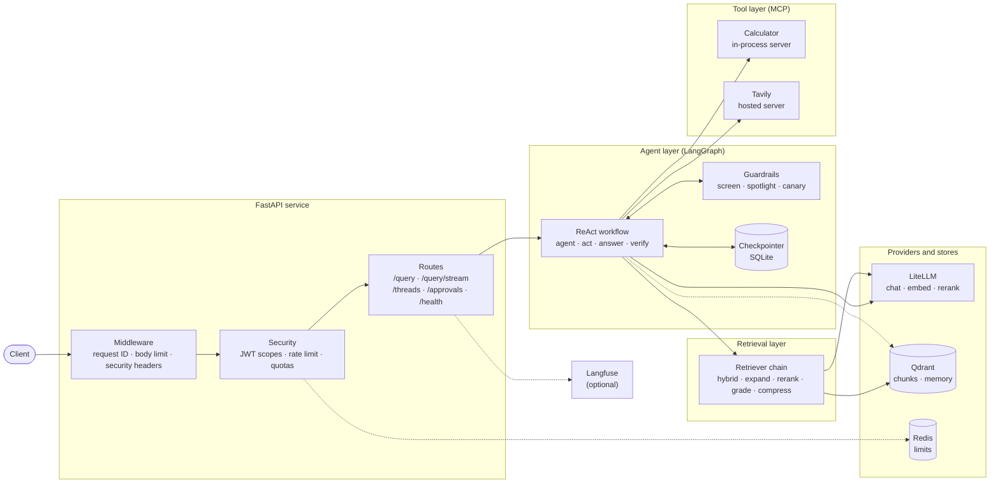
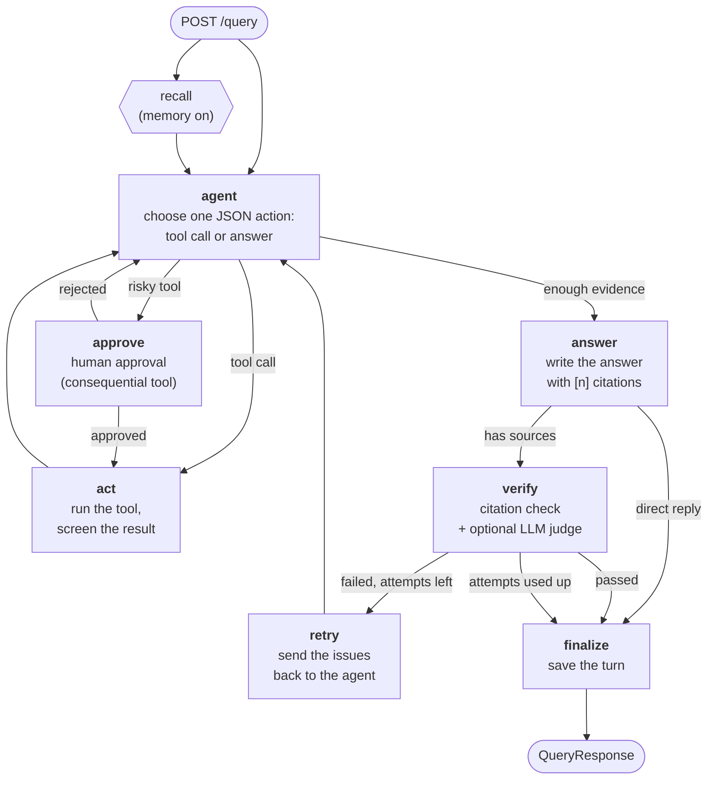
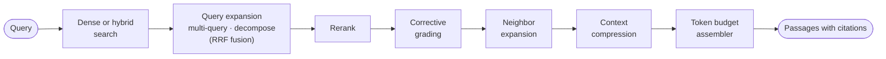
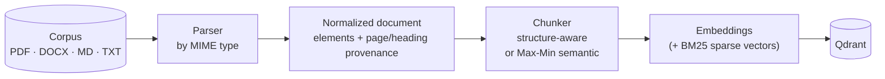

<div align="center">

# InsightFlow

**An API-first, multi-agent RAG platform: a verified, cited answer for every question, with security and observability built in.**

[](https://github.com/Djalal-H/InsightFlow/actions/workflows/ci.yml)
[](LICENSE)
[](https://www.python.org/)
[](https://fastapi.tiangolo.com/)
[](https://langchain-ai.github.io/langgraph/)
[](https://www.litellm.ai/)
[](https://qdrant.tech/)
[](https://modelcontextprotocol.io/)
[](https://redis.io/)
[](#run-it)
[](docs/reference.md#langfuse-traces-opt-in)
[](#quality-and-testing)
[](#quality-and-testing)
[](#quality-and-testing)

</div>

---

## What it does

InsightFlow answers questions about a document corpus (PDF, DOCX, Markdown, text) and, when
needed, about the open web. A LangGraph **ReAct agent** decides at each step whether to search
documents, calculate, or search the web. It then writes an answer with `[n]` citations, and a
**verifier** checks that every citation is real and every claim is supported. A failed check
sends the issues back to the agent for another attempt.

| | |
| --- | --- |
| **Grounded answers** | Cited sources, a citation check without a model, and an optional LLM judge for each claim. |
| **Agentic tools** | Document search, a safe calculator, and web search through the Model Context Protocol. |
| **Tunable retrieval** | Dense and hybrid (BM25) search, query rewriting, reranking, corrective grading, parent context, compression. |
| **Defense in depth** | JWT scopes, per-user threads, Redis rate limits and quotas, prompt-injection guardrails, human approval of risky tools. |
| **Observable** | Request IDs, JSON logs, usage counters in every response, opt-in Langfuse traces. |
| **Measured** | Labeled retrieval and answer evaluation sets with baselines and regression gates. |

## Architecture

### System view



### The query workflow

Each request builds one LangGraph state machine. Routing functions are pure, so the graph is
tested without a model.



The loop always ends. The agent answers without a model call after `AGENT_MAX_STEPS` actions
or after a repeated call, and unreadable model output falls back to one plain search. State
for each turn is reset by `new_turn_input`, while the conversation history persists in the
checkpointer.

### The retrieval chain

Every stage is a `Retriever` or a `CandidateProcessor`, so the agent sees only one protocol.
Each stage is a setting, off by default, and measured with `insightflow.evaluate` before use.



### The ingestion pipeline



Identifiers are deterministic (uuid5 over the corpus-relative path and a content checksum), and
an index fingerprint skips unchanged documents. A rerun of ingestion costs nothing when the
corpus, parser, chunker, and embedding model are the same.

### Design decisions

- **A modular monolith with protocol boundaries.** `ChatProvider`, `EmbeddingProvider`,
  `RerankProvider`, `Retriever`, `ChunkStore`, and `ToolClient` are protocols. LiteLLM, Qdrant,
  and MCP types never cross them, so each adapter can be replaced alone.
- **Prompted JSON instead of native function calling.** The agent works with any chat model,
  including ones that LiteLLM does not list as tool-capable. Unreadable JSON always falls back
  to a safe default instead of an error.
- **Evidence before features.** Retrieval techniques are options with measured results, not
  assumptions. Embedding input types alone moved the hit rate from 0.500 to 0.979.
- **Failures are data.** A tool failure is an observation the agent can react to. Provider and
  storage failures map to stable, sanitized error codes.
- **Security as settings.** `APP_ENV=production` refuses to start without authentication, rate
  limits, and JSON logs.

## Results

Measured on the 48-question labeled retrieval set (`nvidia_nim/nvidia/nemotron-3-embed-1b`):

| Variant | hit | recall | mrr | context tokens |
| --- | --- | --- | --- | --- |
| dense, no embedding input types | 0.500 | 0.469 | 0.398 | 1818 |
| **dense** | **0.979** | **0.979** | 0.915 | 1147 |
| hybrid | 0.979 | 0.958 | 0.924 | 1725 |
| dense + neighbors | 0.979 | 0.979 | 0.915 | 1624 |
| hybrid + neighbors | 0.979 | 0.958 | 0.913 | 3083 |

Measured on the 28-question end-to-end answer set (full workflow, LLM judge):

| Metric | Result |
| --- | --- |
| Fact recall | 0.960 (judge: 0.940) |
| Citations valid | 1.000 |
| Source coverage | 0.960 |
| Verification passed | 0.893 |
| `dense + corrective` retrieval | hit 1.000, mrr 0.979, **268 context tokens instead of 1147** |

## Features

<details open>
<summary><b>RAG pipeline</b></summary>

- Parsers for PDF (Docling), DOCX, Markdown, and text, all producing one normalized model.
- Two chunkers: a structure-aware recursive chunker and an async **Max-Min semantic chunker**
  that embeds sentences and keeps tables, code, and headings atomic.
- Asymmetric embedding support (`query` and `passage` input types).
- Hybrid retrieval with hashed BM25 sparse vectors and reciprocal rank fusion in Qdrant, with
  no local model.
- Metadata filters by file type and source, from the request or from the agent.
</details>

<details>
<summary><b>Agent and tools</b></summary>

- ReAct loop with a step budget, repeat detection, and bounded retries.
- Tools through an MCP client with an allowlist, JSON-schema argument checks, timeouts, output
  limits, and a cooldown for failing servers.
- An in-repo calculator MCP server that parses with `ast` and never uses `eval`.
- Optional web search (Tavily), with pages screened before they reach a prompt.
- Persistent threads (SQLite checkpointer) and optional semantic conversation memory in Qdrant.
- SSE streaming of nodes, tokens, retries, and approval requests.
</details>

<details>
<summary><b>Security</b></summary>

- JWT authentication (JWKS or shared secret) with five scopes, and per-user thread ownership.
- Redis rate limits (GCRA in one Lua script), request quotas, and daily token quotas.
- Six guardrail layers against prompt injection: least privilege, spotlighting, input screening,
  answer canaries and link checks, an optional safety model, and hard limits. A 34-case
  regression set covers attacks and benign controls.
- Human-in-the-loop approval for any tool that is not on a read-only list (LangGraph `interrupt`).
- Secrets as `SecretStr` or files, log redaction, and security headers.
</details>

<details>
<summary><b>Observability and evaluation</b></summary>

- A run recorder per request: model calls, tokens, store and tool calls, errors by code, and
  time per node, returned in `metadata.usage`.
- JSON logs with request, thread, and node context. Questions and answers are never logged.
- Opt-in Langfuse traces: a span per node, an observation per model, store, and tool call.
- Retrieval evaluation with a baseline gate (exit code 3 on a regression) and answer evaluation
  with a call and token budget.
</details>

<details>
<summary><b>Operations</b></summary>

- Two Docker images: a slim API image (no Docling, no torch) and an ingestion image.
- Non-root, read-only root file system, dropped capabilities.
- Backups, restores, collection aliases for zero-downtime re-indexing, and thread retention in
  one CLI (`insightflow.ops`).
- CI with Ruff, strict mypy, Python 3.12 and 3.13, service-container tests, image smoke tests,
  and `pip-audit`.
</details>

## Run it

```bash
# 1. Install
python3.12 -m venv .venv && source .venv/bin/activate
python -m pip install -r requirements-dev.txt

# 2. Configure: set the model keys and names
cp .env.example .env

# 3. Start the vector store and index the sample corpus
docker compose up -d qdrant
PYTHONPATH=src python -m insightflow.ingest corpus/

# 4. Start the API
uvicorn insightflow.main:app --app-dir src --reload
```

Ask a question:

```bash
curl -s localhost:8000/query -H 'content-type: application/json' \
  -d '{"query": "What is 15% of the annual tuition fee?"}'
```

```json
{
  "answer": "15% of the 1200 dollar fee [1] is 180.",
  "sources": [{"kind": "document", "citation": 1, "source_name": "tuition.docx", "score": 0.82}],
  "thread_id": "3f1c…",
  "verification": {"status": "passed", "method": "llm", "issues": []},
  "metadata": {
    "attempts": 1,
    "nodes": ["agent", "act", "agent", "act", "agent", "answer", "verify", "finalize"],
    "duration_ms": 4120
  }
}
```

Stream the same run with `POST /query/stream` (Server-Sent Events), or run everything in
containers:

```bash
docker compose --profile app up -d --build   # Qdrant, Redis, and the API
```

## Repository map

```text
src/insightflow/
├── api/            FastAPI routes, dependencies, middleware, error mapping
├── agents/         LangGraph state, graph, nodes, memory, checkpointer
├── rag/            parsers, chunkers, ingestion, retrieval chain, sparse encoder
├── providers/      chat, embedding, rerank protocols + LiteLLM adapters
├── tools/          MCP client, tool registry, calculator server, web search
├── storage/        Qdrant stores, Redis client, backups
├── security/       JWT auth, rate limits and quotas, audit log
├── guardrails/     input screen, spotlighting, answer checks, safety classifier
├── observability/  Langfuse trace sink
├── evaluation/     retrieval and answer scoring
└── core/           settings, logging, run records, errors
evaluation/         labeled cases and baselines
corpus/             sample documents (DOCX, MD, PDF, TXT)
tests/              unit and integration tests
```

## Quality and testing

```bash
ruff check src tests     # lint
mypy src                 # strict type checking
pytest                   # 773 tests, no credentials and no Qdrant needed
```

The default suite uses scripted model fakes, in-memory Qdrant, and `fakeredis`, so it needs no
network. Opt-in markers run the same contracts against real services (`qdrant`, `redis`,
`tavily`, `langfuse`). Four JSONL regression sets (structured outputs, workflow routing,
prompt injection, and retrieval) guard behavior changes.

## Documentation

- [Reference](docs/reference.md): every setting and behavior (ingestion, query API, streaming,
  threads and memory, retrieval options, evaluation, MCP tools, security, observability).
- [Operations](docs/operations.md): images, secrets, backups, restores, re-indexing, retention,
  and load tests.
- [`.env.example`](.env.example): all configuration, with comments.

## Tech stack

Python 3.12+ · FastAPI · Pydantic v2 · LangGraph · LiteLLM · Qdrant · Redis · Model Context
Protocol · Docling · Langfuse (OpenTelemetry) · PyJWT · Docker · GitHub Actions · pytest · Ruff · mypy

## Contributors

- Ahmed Djalal HACINI
- Lina Wafaa Bentiba

## License

Released under the [MIT License](LICENSE).
